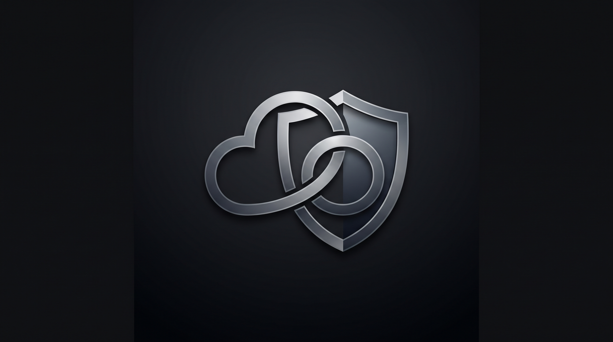

<div align="center">
  
  <h1>AetherVault</h1>
  <p><strong>Next-Generation Cloud Disaster Recovery & Resilient Command Center</strong></p>
  <p><em>Built by Aegis Core Labs • Founded by Antonio Nwozo</em></p>
</div>

---

## 🛡️ Executive Overview

**AetherVault** bridges enterprise-grade, zero-trust cloud disaster recovery with a flawless, Apple-inspired consumer aesthetic. Designed for mission-critical multi-cloud resilience, AetherVault delivers real-time sub-second RPO streaming, 3D global network topology visualization, and 1-click automated failover between primary on-premises/cloud nodes and remote targets.

---

## ⚡ Core Platform Capabilities

- **3D Global Topology HUD:** 60FPS interactive Three.js globe visualizing active eBPF encrypted data conduits between source regions (`us-east-1`) and dynamic targets (GCP, AWS, Azure).
- **Sub-Second RPO Telemetry:** Real-time stream tracking continuous replication lag, sync health, and automated state transitions.
- **Accidental-Click Guard (Hold-to-Initiate):** Requires an intentional 1.2s confirmation hold with procedural cybernetic audio ramping and mobile haptic feedback.
- **Multi-Cloud Target Selection:** Real-time routing flexibility targeting **GCP us-central1 (Iowa)**, **AWS us-west-2 (Oregon)**, and **Azure East US 2 (Virginia)**.
- **SDET Chaos Simulation:** Integrated fault injection simulating network jitter, packet turbulence, and dropped frames to prove platform resilience.
- **Zero-Cost Synthesizer Engine:** Native HTML5 Web Audio API synthesizing ascending charge sweeps, cutover bass drops, and harmonic resolution chimes without paid assets.

---

## 🚀 Quickstart & Local Execution

```bash
# 1. Clone repository
git clone https://github.com/Anwozo157/AetherVault.git
cd AetherVault

# 2. Install dependencies (React 18, Three.js, React Three Fiber, Framer Motion)
npm install --legacy-peer-deps

# 3. Launch Command Center
npm run dev

# 4. Run the test suite (Vitest + Testing Library)
npm test
```

Open `http://localhost:5174` in your browser.

---

## 📱 Live Production Mobile & Web Demo for Stakeholders

- **Live URL:** [https://anwozo157.github.io/AetherVault/](https://anwozo157.github.io/AetherVault/)
- **Zero Infrastructure Cost:** Hosted permanently via GitHub Pages ($0.00/mo).
- **Mobile Optimized:** Full touch support on iOS & Android browsers for 3D globe gesture rotation and hold-to-failover haptics.

<div align="center">
  
  <p><em>Scan with iPhone or Android camera for instant live demo</em></p>
</div>

---

## 📄 Licensing & Governance

Copyright © 2026 Aegis Core Labs / Antonio Nwozo. All Rights Reserved.
