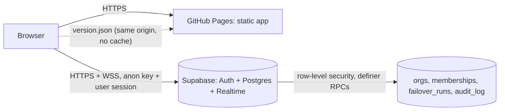

# Security

> AetherVault is a vault that assumes the worst. This document is the threat model, the
> controls in place, and the runbooks for keys, passwords and incidents.
> Last reviewed: 2026-11-09. Review at every phase change and at least quarterly.

## Principles

1. **No secrets in code.** Browsers get only public values (the Supabase anon key is public by design). Secret keys live in the hosting platform's secret store, never in git, `.env` files that builds read, or chat.
2. **Enforce in the database, not the UI.** Row-level security, constraints and `SECURITY DEFINER` functions decide who may do what. A bug or a modified browser cannot bypass them.
3. **Assume history will be attacked.** The audit log is append-only and hash-chained; tampering is detectable by anyone in the organization, at any time.
4. **Two people for dangerous actions.** A failover needs a requester and a different approver.
5. **Least privilege, least data.** No third-party calls the product does not need; no analytics or trackers.

## Is the code encrypted?

Not the code itself, by design. Web apps run in the visitor's browser, which must read the code to run it. Hiding or encrypting it ("obfuscation") is routinely undone and protects nothing. What is protected:

| What                                 | Protection                                                                                                        | Where                        |
| ------------------------------------ | ----------------------------------------------------------------------------------------------------------------- | ---------------------------- |
| Traffic between browser and site     | HTTPS (TLS)                                                                                                       | GitHub Pages enforces HTTPS  |
| Traffic between browser and database | HTTPS + secure websockets (TLS)                                                                                   | Supabase (hosted, Phase 3.6) |
| User passwords                       | Never stored; Supabase Auth stores bcrypt hashes                                                                  | Supabase Auth                |
| Data at rest                         | Encrypted disks on the hosted database (per Supabase's security docs; confirm when the hosted project is created) | Supabase                     |
| Audit history                        | SHA-256 hash chain; any edit is detected by "Verify chain"                                                        | `audit_log` table            |
| Source code integrity                | Git history, CI on every change, code scanning, secret scanning                                                   | GitHub                       |

## Data flow

The public demo talks only to its own origin. The signed-in console also talks to one configured database origin; the Content-Security-Policy allows nothing else.

## Threat model

| Threat                                  | Example                                        | Control                                                                                                                | Status                                                  |
| --------------------------------------- | ---------------------------------------------- | ---------------------------------------------------------------------------------------------------------------------- | ------------------------------------------------------- |
| Injected script steals sessions or data | XSS via a compromised dependency or user text  | Content-Security-Policy `script-src 'self'` (no inline, no eval); React escapes text; CSP tested on every screen in CI | ✅                                                      |
| Data sent to an attacker's server       | Malicious code exfiltrates data                | CSP `connect-src` limited to the site and its database                                                                 | ✅                                                      |
| One insider triggers a failover         | Rogue or phished operator                      | Two-person approval enforced by a database constraint                                                                  | ✅                                                      |
| Viewer escalates privileges             | Edits requests in the browser                  | Row-level security; writes only through role-checked functions                                                         | ✅                                                      |
| Someone joins an organization uninvited | Signs up with a look-alike or unverified email | Invites match the exact, lower-cased, **verified** email only; only admins invite; every join is audited               | ✅                                                      |
| An organization loses all admins        | An admin removes or demotes themselves         | Database refuses self-removal and self-demotion                                                                        | ✅                                                      |
| Someone rewrites history                | DB admin edits an audit entry                  | Append-only triggers + SHA-256 chain; Verify names the altered entry (tested end-to-end)                               | ✅                                                      |
| Leaked secret in git                    | Key committed by mistake                       | gitleaks scan of full history in CI; `.env.*` ignored; deploy refuses builds with local URLs                           | ✅                                                      |
| Vulnerable dependency                   | Known CVE in a library                         | `npm audit` in CI, Dependabot, CodeQL                                                                                  | ✅                                                      |
| Exported audit CSV attacks the auditor  | Spreadsheet formula injection                  | Formula-leading cells neutralized                                                                                      | ✅                                                      |
| Clickjacking (site framed by attacker)  | Hidden iframe tricks a click                   | Needs an HTTP `frame-ancestors` header; GitHub Pages cannot send headers                                               | ⏳ custom domain / host with headers (requires funding) |
| Account takeover of the founder         | Phished GitHub or cloud password               | 2FA everywhere; recovery codes stored offline (see runbook)                                                            | ⚠️ verify 2FA on every account below                    |
| Hosted database misconfiguration        | RLS disabled in the dashboard                  | Migrations are the only source of schema; CI runs RLS tests                                                            | ⏳ Phase 3.6 hosting                                    |

## Controls running on every change (CI)

- Lint, strict TypeScript, 140+ unit tests with coverage thresholds, production build, bundle budget.
- Production dependency audit (`npm audit --omit=dev --audit-level=high`).
- Playwright end-to-end tests, desktop and mobile, including the Content-Security-Policy check.
- Local Supabase: 60 pgTAP database tests (roles, two-person rule, tamper detection) and the two-browser console suite.
- CodeQL static analysis; gitleaks secret scan of the full git history.

## Credentials: inventory, backup and rotation

Store every password in one password manager (Apple Passwords/iCloud Keychain is free and already used for the GitHub recovery codes). Turn on 2FA everywhere. Keep recovery codes in two places: the password manager and an offline copy (printed, in a safe place).

| Account / key                                 | Holds                                    | 2FA                 | Backup of recovery                              | Rotate                                                                       |
| --------------------------------------------- | ---------------------------------------- | ------------------- | ----------------------------------------------- | ---------------------------------------------------------------------------- |
| GitHub account (Anwozo157)                    | Code, CI, website                        | Required            | Recovery codes in macOS Keychain + offline copy | Password yearly or on suspicion; review authorized apps and tokens quarterly |
| Apple ID                                      | iCloud (Obsidian vault backup), Keychain | Required            | Recovery key offline                            | On suspicion                                                                 |
| Supabase account (Phase 3.6)                  | Hosted database                          | Required            | Recovery codes in Keychain + offline            | Password yearly                                                              |
| Supabase `service_role` key                   | Full database access                     | n/a                 | Never copied anywhere except Supabase secrets   | Rotate (JWT secret) on any suspicion, and before each team change            |
| Supabase anon key                             | Public, protected by RLS                 | n/a                 | n/a                                             | Rotates with the JWT secret                                                  |
| AWS root (when funded)                        | Billing, everything                      | Hardware or app MFA | Offline                                         | Never use day to day; no root access keys ever                               |
| AWS IAM / Identity Center users (when funded) | Daily work                               | MFA                 | n/a                                             | Access keys avoided; if used, 90 days                                        |
| Domain registrar (when funded)                | Website name                             | Required            | Offline                                         | Enable registrar lock                                                        |

**Day one of any AWS account:** create a Budgets alert (e.g. $50/month) and enable MFA on root before anything else.

## Incident runbook (a key or password leaks)

1. **Contain:** rotate the exposed secret immediately (Supabase: rotate JWT secret; GitHub: revoke token/change password and sign out all sessions; AWS: deactivate the key).
2. **Assess:** check the audit log ("Verify chain"), GitHub security log, Supabase logs, AWS CloudTrail for activity since the leak.
3. **Clean:** if the secret is in git history, rotating it is the fix; rewriting history is optional and never sufficient alone.
4. **Record:** write what happened, when it was detected, and what changed, in `docs/incidents/`.
5. **Notify:** if customer data could be affected, notify customers and follow applicable law (e.g. SEC Item 1.05 for public-company customers' own obligations).

## Reporting a vulnerability

Use GitHub's private vulnerability reporting on this repository (Security tab → "Report a vulnerability"). Please do not open a public issue. We aim to acknowledge within 3 business days.

## Known gaps (tracked)

- `frame-ancestors` / other HTTP security headers need a host that sends headers (custom domain on a CDN; requires funding).
- Hosted backend not yet created (Phase 3.6); its dashboard settings must match `supabase/config.toml` (disable password sign-ups, enable leaked-password protection, rate limits).
- No third-party penetration test or SOC 2 yet (when customers require it). Readiness self-assessment and free next steps: `docs/SOC2_READINESS.md`.
